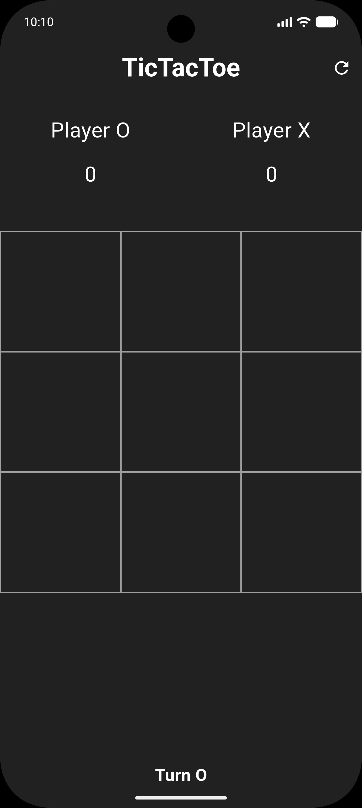
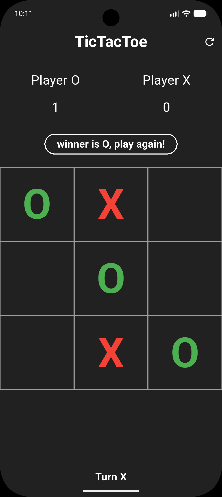
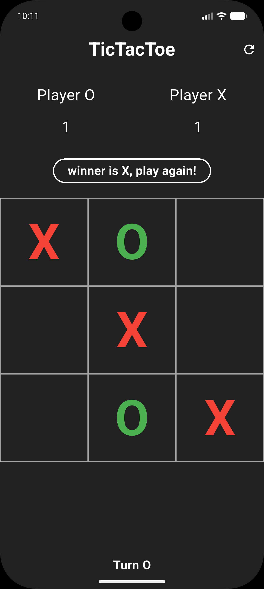
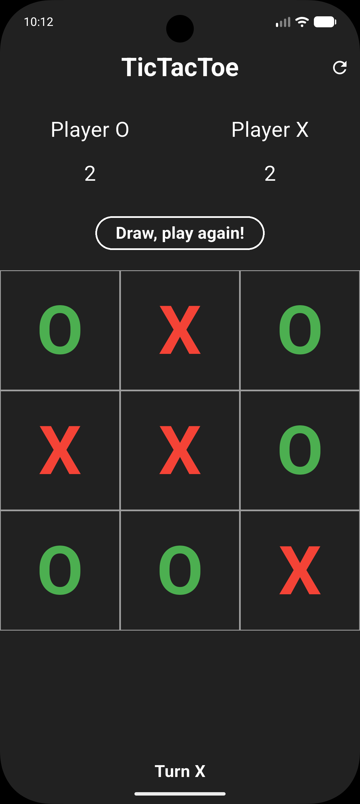

[English](README.md) | [فارسی](README.fa.md)

# TicTacToe

A two-player tic-tac-toe game built with Flutter. Share a device, take turns, and keep score across rounds—all on one screen.


[](LICENSE)

## Screenshots

| New game | O wins | X wins | Draw |
| :---: | :---: | :---: | :---: |
|  |  |  |  |

These images live in `assets/screenshots/` and are used only in the documentation. They do not need an asset entry in `pubspec.yaml`.

## Features

- Local two-player play on a 3 × 3 board, with O taking the first turn after a full reset.
- A turn indicator and distinct colors: green for O, red for X.
- Win detection across all rows, columns, and diagonals, plus draw detection when the board is full.
- Occupied cells cannot be overwritten, and the board stops accepting moves once a round ends.
- A scoreboard that carries over between rounds.
- A result button to clear the board and play another round without losing the scores.
- A refresh button to reset the board, scores, and starting turn.
- A dark interface built with Flutter's Material widgets.

### How rounds and scores work

Tap an empty cell to place the current player's mark. A win adds one point to the winner. **A draw adds one point to both players**, matching the current implementation.

The **play again** button clears the board and keeps the scores. It also keeps the next turn from the previous round rather than always starting with O. The app-bar **refresh** button starts a fresh session: both scores return to zero and O goes first.

Game state is held in memory; it is not saved between app launches. There is no computer opponent, online multiplayer, account system, or backend. The app's interface is currently in English; the Persian translation here is for the documentation.

## Tech stack and architecture

This is a small, single-screen Flutter app with a screen-based structure. The UI and game rules live together in `HomeScreen`; there are no separate data, domain, or repository layers, and no Clean Architecture or MVVM setup.

**State Management** uses a `StatefulWidget` and Flutter's built-in `setState`. `_HomeScreenState` holds the nine board cells, current turn, filled-cell count, round result, and both scores.

### Project details

- **Package name:** `tictactoe`
- **Version:** `1.0.0+1`
- **Dart SDK constraint:** `^3.12.0` (`>=3.12.0 <4.0.0`)
- **Package description:** `pubspec.yaml` still contains the starter text, `A new Flutter project.`
- **Platform folders included:** Android, web, and Windows. This checkout does not contain iOS, macOS, or Linux runners.

### Packages

- **`flutter`** — SDK dependency providing Material widgets, layout, and the app runtime.
- **`cupertino_icons: ^1.0.8`** — Cupertino icon package declared in `pubspec.yaml`; the current game screen uses Material icons instead.
- **`flutter_test`** — SDK development dependency for tests. No `test/` directory is currently included.
- **`flutter_lints: ^6.0.0`** — recommended analyzer rules, enabled through `analysis_options.yaml`.

There are no additional State Management, networking, local-storage, or UI packages, and no `build_runner` or other code-generation setup.

### Directory structure

```text
lib/
├── main.dart                 # Entry point, Application, and MaterialApp
└── screens/
    └── home_screen.dart      # Board, scoreboard, turns, results, and reset logic

assets/
└── screenshots/              # Four images used by the READMEs

android/                      # Android runner and build configuration
web/                          # Web runner, manifest, and icons
windows/                      # Windows runner and CMake configuration
pubspec.yaml                  # Package metadata and dependencies
analysis_options.yaml         # Flutter lint configuration
```

`main.dart` launches `Application`, whose `MaterialApp` opens `HomeScreen`. In `home_screen.dart`, `tapped` handles moves, `checkWinner` checks the eight winning lines and draws, and `setResult` updates the result and scores. `clearGameBoard` prepares another round; `clearGame` resets the whole session.

## Getting started

### 1. Prepare Flutter and a target device

Install a Flutter SDK that includes **Dart 3.12.0 or later, below 4.0.0**, and make sure `flutter` is available on your `PATH`.

```bash
flutter --version
flutter doctor
```

Prepare the tools for the target you want to run:

- **Android:** Android Studio/Android SDK and an emulator or a connected device. The Android build targets Java 17; use a compatible JDK.
- **Web:** Chrome for the development command below.
- **Windows:** a Windows machine with Visual Studio and the **Desktop development with C++** workload.

### 2. Clone the repository

Replace `YOUR_REPOSITORY_URL` with this repository's clone URL. No `origin` URL is configured in the inspected checkout, so a specific hosting URL is not assumed here.

```bash
git clone "YOUR_REPOSITORY_URL" tictactoe
cd tictactoe
```

If you already have the project locally, open its root directory instead.

### 3. Install dependencies

```bash
flutter pub get
```

No code-generation command is needed. There are also no API keys, environment files, or backend services to configure.

### 4. Run the app

Start an emulator or connect a device, then run:

```bash
flutter devices
flutter run
```

To choose a target explicitly, use one of these commands:

```bash
flutter run -d chrome
flutter run -d windows
```

For Android, use `flutter run -d DEVICE_ID`, replacing `DEVICE_ID` with an Android device ID from `flutter devices`. Windows builds must be run on Windows.

### 5. Check the code

```bash
flutter analyze
```

`flutter_test` is available as a development dependency, but this checkout has no test files yet. Once tests are added under `test/`, run them with `flutter test`.

## Repository language statistics

`.gitattributes` marks platform runner folders as `linguist-vendored=true` and generated Dart files (`*.g.dart` and `*.freezed.dart`) as `linguist-generated=true`. This excludes those files from GitHub Linguist's language calculation so the handwritten Dart code represents the app. It does not change Flutter builds or runtime behavior.

## License

Released under the [MIT License](LICENSE). Copyright © 2026 Mehrshad Khodavirdizadeh.
